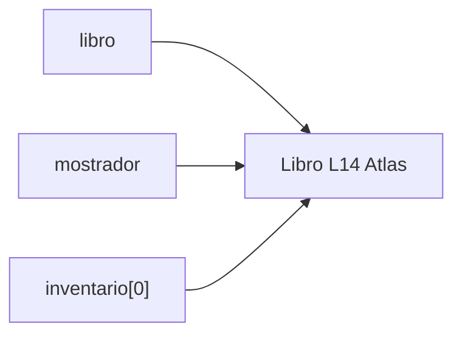
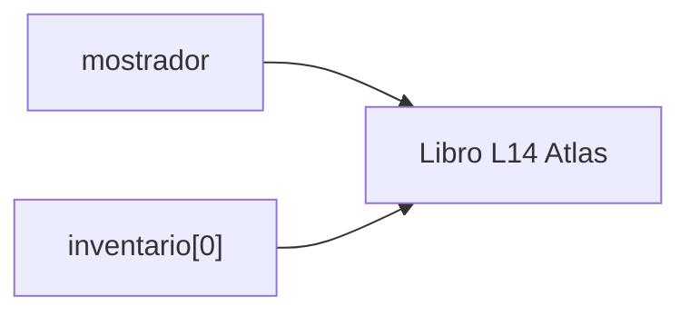
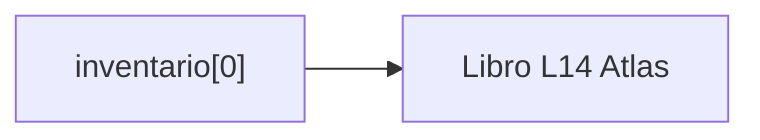
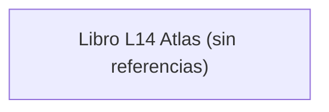

# Ejercicio 6 · Diagrama de referencias

## 1. Justo antes de `del libro`

## 2. Justo después de `del libro`

## 3. Después de `del mostrador`

## 4. Después de `inventario.clear()`

Solo hay un objeto. Los nombres son flechas hacia él: `del` quita una flecha,
no borra el objeto. Cuando no queda ninguna flecha, Python puede liberarlo.

#PARA PROBAR COMO SE VE VISULAMENTE USA CRTL + SHIFT + V